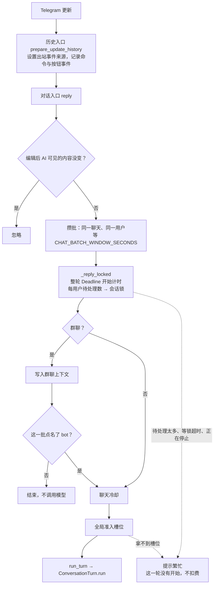
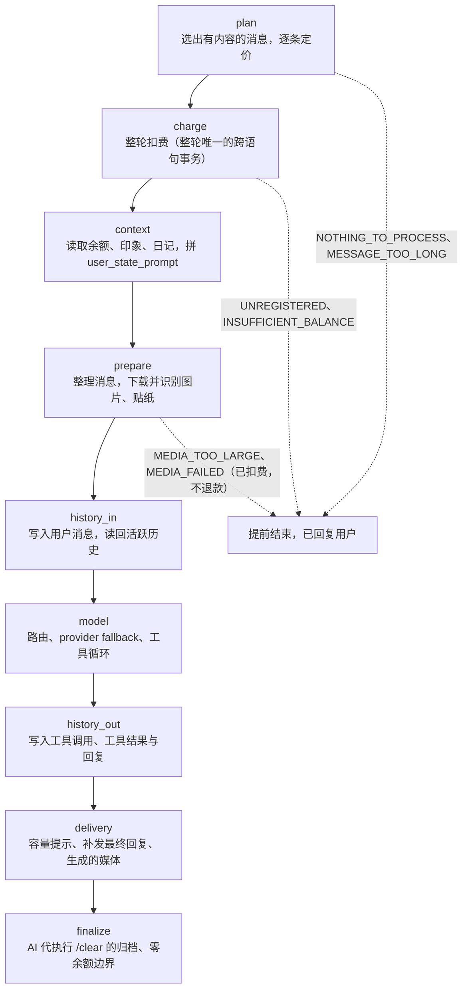
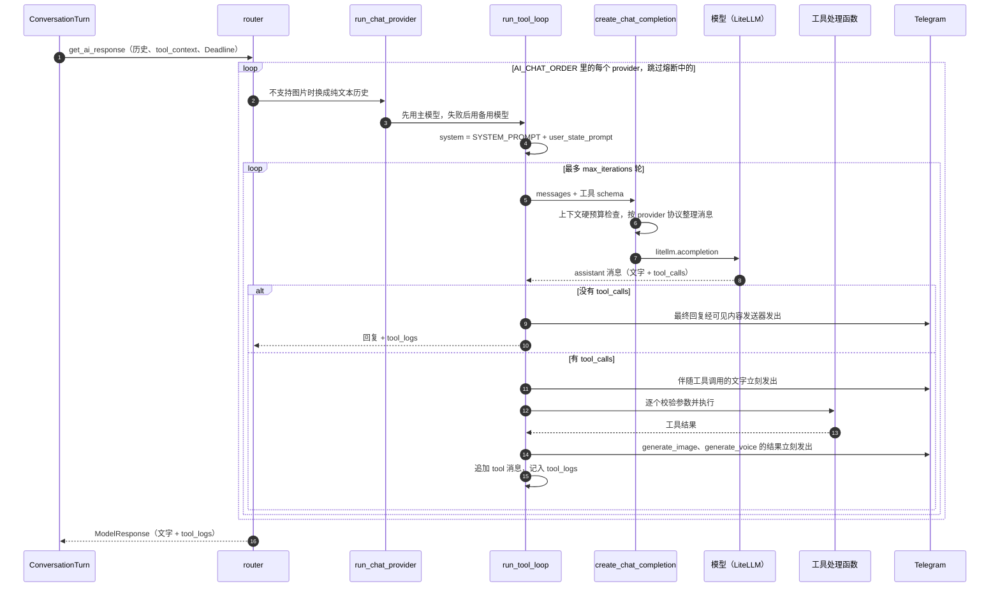
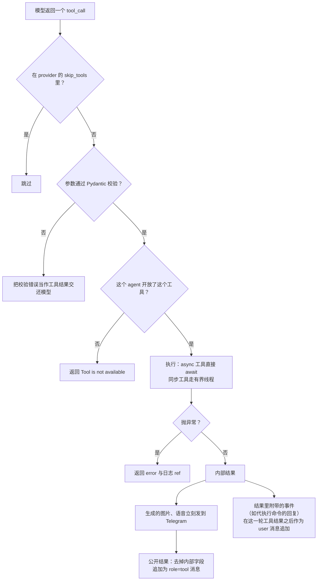
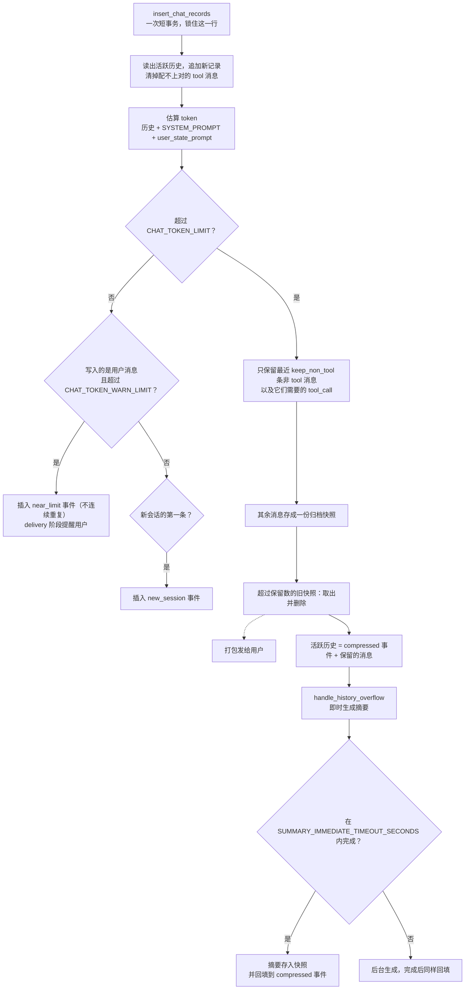
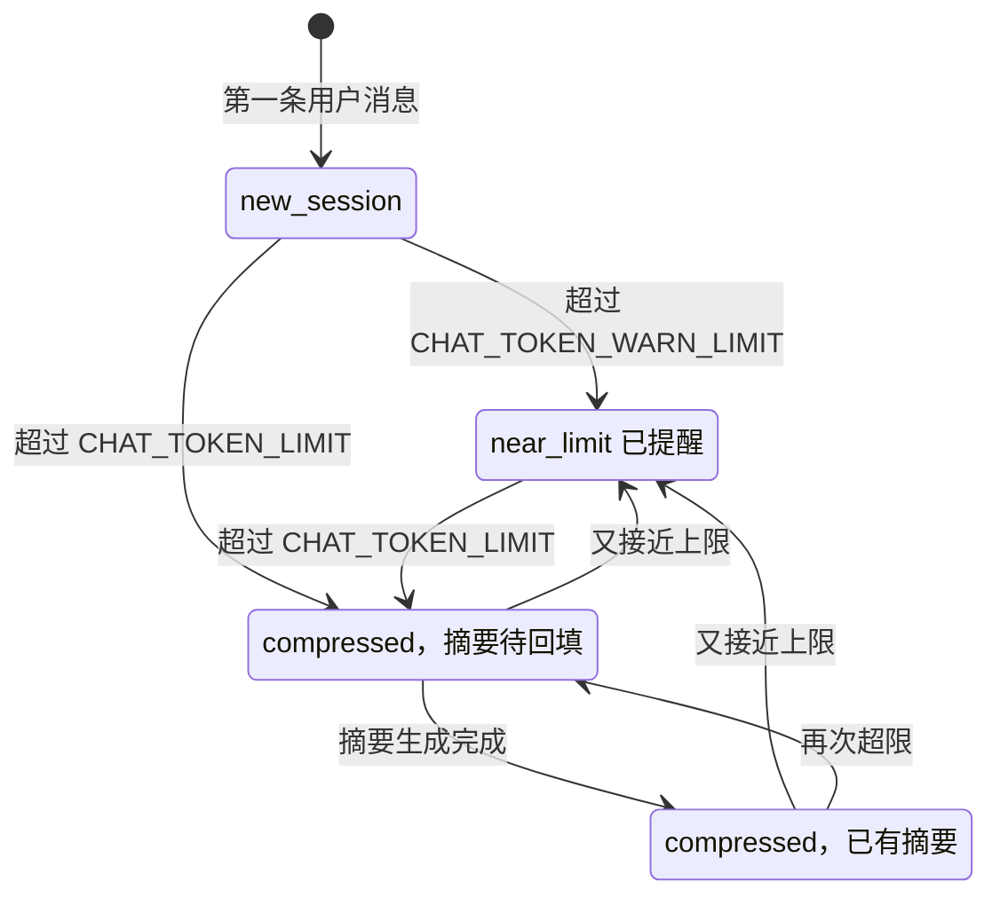

# AI 对话流程

本页把一轮 AI 对话串成图：从收到 Telegram 消息、调用模型与工具，到写回历史、压缩与生成摘要。
各环节的规则分别在 [architecture.md](architecture.md) 的「一轮对话」、
[ai-provider-architecture.md](ai-provider-architecture.md)（provider、fallback）与 [runtime.md](runtime.md)（准入、截止时间）里，
本页只画它们怎么连起来，不重复规则。

权威定义是代码。标着「自动生成」的块由 `scripts/gen_ai_flow_doc.py` 从代码生成，改了工具、阶段或阈值之后运行：

```bash
uv run python scripts/gen_ai_flow_doc.py
```

`tests/test_ai_flow_doc.py` 检查两件事：生成块有没有过期；正文里用反引号引用的符号、文件与相对链接是否还存在。
图里的节点在每张图下面的表里都写了对应的代码，改名或删除时测试会指出来。

## 1. 一条消息怎么进来



| 图中节点 | 代码 | 文件 |
|---|---|---|
| 历史入口 | `prepare_update_history`、`HistoryTrackingExtBot`（bot 发出的消息也记入历史） | [core/telegram_history.py](../src/fogmoe_telegram_bot/core/telegram_history.py) |
| 对话入口、准入、建立请求 | `reply`、`_reply_locked`、`_reply_batch_unlocked`、`_build_turn_request` | [conversation/handlers.py](../src/fogmoe_telegram_bot/features/conversation/handlers.py) |
| 编辑去重 | `_record_message_content_and_check_unchanged_edit` | [conversation/messages.py](../src/fogmoe_telegram_bot/features/conversation/messages.py) |
| 攒批 | `_message_batch_key`、`_MESSAGE_BATCHES` | [conversation/batching.py](../src/fogmoe_telegram_bot/features/conversation/batching.py) |
| 每用户待处理数、全局槽位 | `AdmissionController`、`user_pending`、`slot` | [core/admission.py](../src/fogmoe_telegram_bot/core/admission.py) |
| 会话锁 | `get_conversation_lock` | [ai/conversation_locks.py](../src/fogmoe_telegram_bot/features/ai/conversation_locks.py) |
| 群聊上下文 | `log_group_message`，表 `chat_records_group` | [core/group_chat_history.py](../src/fogmoe_telegram_bot/core/group_chat_history.py) |
| 聊天冷却 | `check_chat_cooldown` | [core/command_cooldown.py](../src/fogmoe_telegram_bot/core/command_cooldown.py) |

## 2. 一轮对话的阶段

阶段顺序（自动生成，来自 `Stage`）：

<!-- BEGIN GENERATED: stages -->
`plan` → `charge` → `context` → `prepare` → `history_in` → `model` → `history_out` → `delivery` → `finalize`
<!-- END GENERATED: stages -->



| 阶段 | 代码 | 文件 |
|---|---|---|
| 总流程 | `ConversationTurn.run`、`StageTimer` | [conversation/turn.py](../src/fogmoe_telegram_bot/features/conversation/turn.py)、[conversation/turn_types.py](../src/fogmoe_telegram_bot/features/conversation/turn_types.py) |
| `plan`、`charge` | `_plan`、`_charge`、`charge_turn` | [conversation/billing.py](../src/fogmoe_telegram_bot/features/conversation/billing.py) |
| `context` | `_load_context`、`format_user_state_prompt` | [core/prompt_utils.py](../src/fogmoe_telegram_bot/core/prompt_utils.py) |
| `prepare` | `_prepare_inputs`（媒体在历史里只存描述，原图只通过 `runtime_replacements` 给这一次请求） | [conversation/turn.py](../src/fogmoe_telegram_bot/features/conversation/turn.py) |
| `history_in` | `_record_input` → `insert_records`、`get_history` | [conversation/turn_services.py](../src/fogmoe_telegram_bot/features/conversation/turn_services.py) |
| `model` | `_run_model` → `run_model`（`ModelRequest` / `ModelResponse`） | 见第 3 节 |
| `history_out` | `_record_output`、`tool_logs_to_record_entries` | [ai/tool_history.py](../src/fogmoe_telegram_bot/features/ai/tool_history.py) |
| `delivery` | `_deliver`、`_deliver_messages` | [conversation/turn.py](../src/fogmoe_telegram_bot/features/conversation/turn.py) |
| `finalize` | `_finalize`、`archive_completed_clear`、`flush_events` | [conversation/turn_services.py](../src/fogmoe_telegram_bot/features/conversation/turn_services.py) |
| 每次写入历史后的收尾 | `_persist_records`：打包发送被淘汰的归档、容量提示、溢出时生成摘要 | [conversation/turn.py](../src/fogmoe_telegram_bot/features/conversation/turn.py) |

## 3. model 阶段：路由、fallback 与工具循环



失败时不一定换 provider，规则在 [ai-provider-architecture.md](ai-provider-architecture.md) 的「主聊天的 fallback」，这里只列结果：

| 情况 | 结果 |
|---|---|
| 上下文超过硬上限 `ContextBudgetExceededError` | 不换模型也不换 provider，回复固定提示 |
| 工具已经执行过后失败 `PartialAIResponseError` | 不重试（避免重复执行有副作用的工具，比如赠币），回复固定提示 |
| 已经向用户发出可见内容后失败 | 不重试 |
| 安全拦截 `SafetyBlockError` | 按声明决定是否换下一个 provider |
| 整轮截止时间到期 `TurnDeadlineError` | 回复超时提示；正在跑的工具记为结果未知，没轮到的补「未执行」，历史仍然配对 |
| 其他失败 | 记入熔断计数，换下一个 provider；全部失败且带图时用纯文本历史再走一遍 |

| 图中参与者 | 代码 | 文件 |
|---|---|---|
| router | `get_ai_response`、`_try_ai_services`、`_messages_for_service`、`_provider_circuit_is_open` | [ai/router.py](../src/fogmoe_telegram_bot/features/ai/router.py) |
| run_chat_provider | `run_chat_provider`（主模型、备用模型、`skip_tools`） | [ai/chat_provider.py](../src/fogmoe_telegram_bot/features/ai/chat_provider.py) |
| run_tool_loop | `run_tool_loop`、`compose_system_prompt`、`_create_chat_completion_with_post_tool_retries`、`_resolve_assistant_message`、`_emit_visible_content`、`_close_interrupted_round` | [ai/tool_runner.py](../src/fogmoe_telegram_bot/features/ai/tool_runner.py)、[ai/prompts.py](../src/fogmoe_telegram_bot/features/ai/prompts.py) |
| create_chat_completion | `create_chat_completion`、`enforce_messages_context_budget`、`sanitize_messages_for_provider` | [ai/litellm_client.py](../src/fogmoe_telegram_bot/features/ai/litellm_client.py)、[ai/context_budget.py](../src/fogmoe_telegram_bot/features/ai/context_budget.py)、[ai/litellm_message_sanitizer.py](../src/fogmoe_telegram_bot/features/ai/litellm_message_sanitizer.py) |
| Telegram | `TelegramVisibleContentHandler` | [ai/telegram_visible_sender.py](../src/fogmoe_telegram_bot/features/ai/telegram_visible_sender.py) |

## 4. 工具

### 一次工具调用



| 图中节点 | 代码 | 文件 |
|---|---|---|
| 参数校验 | `_validate_tool_args`、`AI_TOOL_ARG_MODELS` | [ai/tool_runner.py](../src/fogmoe_telegram_bot/features/ai/tool_runner.py)、[ai/tools/models.py](../src/fogmoe_telegram_bot/features/ai/tools/models.py) |
| 执行 | `_call_tool`、`get_tool_request_context` | [ai/tools/context.py](../src/fogmoe_telegram_bot/features/ai/tools/context.py) |
| 媒体立刻发送 | `_send_media_result_immediately` | [ai/tool_runner.py](../src/fogmoe_telegram_bot/features/ai/tool_runner.py) |
| 公开结果 | `_public_tool_result` | [ai/tool_runner.py](../src/fogmoe_telegram_bot/features/ai/tool_runner.py) |
| 附带的事件 | `TOOL_CONTEXT_MESSAGES_KEY`、`_context_messages_from_tool_result` | [ai/types.py](../src/fogmoe_telegram_bot/features/ai/types.py) |
| schema 与注册 | `OPENAI_TOOLS`、`AI_TOOL_HANDLERS` | [ai/tools/schemas.py](../src/fogmoe_telegram_bot/features/ai/tools/schemas.py)、[ai/tools/registry.py](../src/fogmoe_telegram_bot/features/ai/tools/registry.py) |

### 工具目录（自动生成）

主聊天用 `OPENAI_TOOLS`；空闲回顾只拿其中的只读工具加上专用的 `read_diary_page`；摘要 agent 只有 `search_prior_context`。
加工具的步骤见 [ai/tools/README.md](../src/fogmoe_telegram_bot/features/ai/tools/README.md)，描述怎么写见
[ai-tool-prompt-guidelines.md](ai-tool-prompt-guidelines.md)。

<!-- BEGIN GENERATED: tools -->
共 20 个工具：主聊天 18 个，空闲回顾 3 个，摘要 1 个。参数后面带 `?` 的是可选参数。

| 工具 | 谁能调用 | 参数 | 处理函数 | 描述（模型看到的原文） |
|---|---|---|---|---|
| `get_help_text` | 主聊天 | — | `memory_tools.get_help_text_tool` | Returns a list of available Telegram commands and features for users |
| `execute_telegram_command` | 主聊天 | `command` | `telegram_command_tools.execute_telegram_command_tool` | Run a Telegram command as the current user in the current chat. The normal command handler sends its mechanical reply directly, and its events enter the conversation before the next model response. Returns execution status only. |
| `read_doc` | 主聊天 | `topic?` | `doc_tools.read_doc_tool` | Read an internal reference document about how this bot's own features work. Omit topic to list every available document with a one-line summary, then call again with a topic to read that one in full. Each fact is documented in exactly one topic and the others defer to it, so follow a cross-reference rather than infer what it omits. Overly long documents are truncated. |
| `list_available_stickers` | 主聊天 | `pack_name?` | `sticker_tools.list_available_stickers_tool` | List configured Telegram sticker packs, their summaries, and currently available emoji choices. Use this before adding sticker directives to a reply. |
| `google_search` | 主聊天 | `query`, `detailed?`, `show_full_json?` | `http_tools.google_search_tool` | Use Google search engine to obtain the latest information and answers |
| `advisor` | 主聊天 | `task`, `case_facts?` | `advisor_tools.advisor_tool` | Submit one complete reasoning task to a read-only senior advisor. Put the question or decision in task. Use case_facts only for facts, evidence, options, and constraints specific to that task. Each call is a single-turn consultation and cannot receive follow-up messages. The advisor cannot use tools or take actions. Its response is advisory material for you to evaluate and synthesize. |
| `fetch_group_context` | 主聊天 | `window_size?` | `memory_tools.fetch_group_context_tool` | Fetch message history from group chat (group chats only) |
| `fetch_url` | 主聊天 | `url` | `http_tools.fetch_url_tool` | Fetch a webpage and return extracted main text for up-to-date browsing. Overly long pages are truncated. |
| `execute_python_code` | 主聊天 | `source_code`, `stdin?` | `code_tools.execute_python_code_tool` | Run Python code remotely and return its output. All results must be printed with print(), otherwise they will not appear in the output. |
| `linux_sandbox` | 主聊天 | `command`, `cwd?`, `timeout_seconds?` | `sandbox_tools.linux_sandbox_tool` | Execute a non-interactive shell command in an isolated temporary Linux sandbox. The sandbox preserves filesystem state across linux_sandbox calls in the same user request, then closes automatically. It lives at most 5 minutes and accepts at most 10 calls per request. Once it closes, the same user cannot open another sandbox for 5 minutes. |
| `generate_image` | 主聊天 | `prompt`, `width?`, `height?`, `steps?`, `seed?`, `timeout_seconds?` | `image_tools.generate_image_tool` | Generate exactly one image from a text prompt. The image is sent to Telegram immediately after the call succeeds. |
| `generate_voice` | 主聊天 | `text` | `voice_tools.generate_voice_tool` | Generate exactly one spoken audio clip from text. The audio is sent to Telegram immediately after the call succeeds. |
| `kindness_gift` | 主聊天 | `amount?` | `user_tools.kindness_gift_tool` | Gift coins to the user. Each user can receive one gift per 24 hours; calling again inside that window gifts nothing and returns a cooldown status. Omit amount to let the system pick one at random. |
| `update_impression` | 主聊天 | `impression` | `user_tools.update_impression_tool` | Replace the stored impression of the user. This overwrites the previous impression entirely instead of appending to it, so carry over everything still worth keeping; the current text is visible as &lt;impression&gt; in the user profile. |
| `fetch_permanent_summaries` | 主聊天、空闲回顾 | `start?`, `end?` | `memory_tools.fetch_permanent_summaries_tool` | Fetch user's historical conversation summaries (newest on top, max 5 results per request) |
| `search_permanent_records` | 主聊天、空闲回顾 | `pattern`, `limit?`, `oldest_first?` | `memory_tools.search_permanent_records_tool` | Search user's permanent chat snapshots with a regex pattern |
| `schedule_ai_message` | 主聊天 | `action?`, `timestamp_utc?`, `recurrence_unit?`, `recurrence_interval?`, `trigger_reason?`, `context?`, `instruction?`, `schedule_id?` | `schedule_tools.schedule_ai_message_tool` | Schedule, list, or cancel one-time or recurring private messages for the user. Use recurrence parameters when creating recurring schedules. UTC timestamps only. Max 3 pending tasks, max 12 total (older tasks are overwritten). |
| `user_diary` | 主聊天 | `action?`, `page?`, `content?`, `title?`, `summary?`, `start_line?`, `end_line?`, `line_numbers?` | `memory_tools.user_diary_tool` | Read or update the internal diary for the current user. For existing pages, start with index to see compact titles and summaries, then read relevant pages. Use patch with start_line/end_line to replace those lines; append adds content at the end. Every content update requires a current summary, and new or previously untitled pages also require a title. When a page exceeds its size limit, the oldest content is truncated. |
| `read_diary_page` | 空闲回顾 | `page` | `memory_tools.read_diary_page_tool` | Read one existing diary page selected from diary_index. This tool is read-only and cannot create, edit, or delete diary pages. |
| `search_prior_context` | 摘要 | `query`, `limit?` | `summary_tools.search_prior_context_tool` | Search up to 20 earlier archived summaries with lightweight BM25 ranking and a small recency boost. Use concrete terms from the current snapshot to resolve older references or continuity. |
<!-- END GENERATED: tools -->

## 5. 上下文记录

### 存在哪里

| 存储 | 内容 | 主要入口 |
|---|---|---|
| 表 `chat_records` 的 `messages` | 每个用户一份活跃历史（JSON 数组，OpenAI 消息格式）。私聊与群聊共用，`conversation_id` 就是用户 id | `insert_chat_records`、`get_chat_history` |
| 表 `permanent_chat_records` | 归档快照 `conversation_snapshot` 与它的摘要 `summary` | 压缩、`/clear`；工具 `fetch_permanent_summaries`、`search_permanent_records` 按需读取 |
| 表 `chat_records_group` | 群聊里的消息，不进活跃历史 | 工具 `fetch_group_context` 按需读取 |
| 用户状态 | 余额、套餐、权限、印象、日记是否存在 | 每次请求拼进 system prompt，不写入历史 |

这些表的读写都在 [core/chat_records.py](../src/fogmoe_telegram_bot/core/chat_records.py)（群聊在
[core/group_chat_history.py](../src/fogmoe_telegram_bot/core/group_chat_history.py)），活跃历史每次写入是一次短事务，`SELECT ... FOR UPDATE` 锁住这一行。

### 活跃历史里有什么

| role | 内容 | 谁写入 |
|---|---|---|
| `user` | 用户消息：`<metadata>` 带聊天类型、时间、用户、消息 id、回复与转发，后面是 `<message>` | `format_user_message` |
| `user` | bot 自己发出的消息、命令回复、按钮事件（`origin` 是 `command_handler` 或 `bot_automation`） | `HistoryTrackingExtBot`、`flush_pending_events` |
| `user` | 历史状态事件 `origin="history_state"`：`new_session`、`near_limit`、`compressed`（之后回填 `<summary>`） | `_build_history_state_event` |
| `user` | 余额状态事件 `origin="coin_service"`：`suspended`、`resumed` | `_build_coin_service_state_event` |
| `assistant` | 回复，以及伴随工具调用的可见文字（都已脱敏） | `_record_output`、`tool_logs_to_record_entries` |
| `assistant` + `tool` | 带 `tool_calls` 的 assistant 消息与对应的 `tool` 结果，`tool_call_id` 一一配对（结果已脱敏） | `tool_logs_to_record_entries` |

### 一次请求长什么样

下面是示意，字段与格式以代码为准。system 消息只在请求里，不写入历史；其余来自活跃历史。

```jsonc
[
  // run_tool_loop 插入：SYSTEM_PROMPT 后面接 user_state_prompt
  {"role": "system", "content": "……<user_state coins=\"120\" user_plan=\"free\" permission=\"0\" permission_label=\"Normal\" diary_exists=\"true\" />\n<user_profile>…</user_profile>"},

  // 上一次压缩留下的事件，摘要生成后回填 <summary>
  {"role": "user", "content": "<metadata type=\"system\" timestamp=\"2026-11-01 08:00:00\" origin=\"history_state\" history_state=\"compressed\">\n  <summary>……</summary>\n</metadata>"},

  // 用户消息
  {"role": "user", "content": "<metadata type=\"private\" timestamp=\"2026-11-03 09:12:30\" user=\"@alice\" message_id=\"42\">\n</metadata>\n<message>明天东京天气怎么样</message>"},

  // 模型要求调用工具；content 是已经发给用户的可见文字
  {"role": "assistant", "content": "我查一下", "tool_calls": [
    {"id": "call_1", "type": "function", "function": {"name": "google_search", "arguments": "{\"query\": \"东京 明天 天气\"}"}}
  ]},

  // 工具结果，tool_call_id 与上面配对
  {"role": "tool", "tool_call_id": "call_1", "name": "google_search", "content": "{\"results\": […]}"},

  // 最终回复
  {"role": "assistant", "content": "明天东京多云……"}
]
```

## 6. 写入与压缩

每次写入活跃历史（用户消息、工具记录、回复、bot 事件）都走同一个函数 `_insert_chat_records_once`：



摘要 agent 把快照整理成文字记录，连同上一份摘要一起交给 `summary` 任务的模型；它可以用 `search_prior_context` 检索更早的摘要。
生成的摘要存进 `permanent_chat_records.summary`，同时回填到活跃历史里那条 `compressed` 事件，于是下一次请求里模型能看到「之前聊过什么」。

| 图中节点 | 代码 | 文件 |
|---|---|---|
| 写入、估算、插入事件 | `insert_chat_records`、`_insert_chat_records_once`、`estimate_conversation_tokens`、`_sanitize_messages_with_tool_pairs` | [core/chat_records.py](../src/fogmoe_telegram_bot/core/chat_records.py)、[core/token_estimator.py](../src/fogmoe_telegram_bot/core/token_estimator.py) |
| 裁剪 | `_trim_messages_with_tool_context` | [core/chat_records.py](../src/fogmoe_telegram_bot/core/chat_records.py) |
| 淘汰旧快照 | `prune_permanent_records`、`send_permanent_records_archive` | [core/archive_utils.py](../src/fogmoe_telegram_bot/core/archive_utils.py) |
| 溢出回调 | `handle_history_overflow`、`handle_snapshot_created` | [conversation/history_hooks.py](../src/fogmoe_telegram_bot/features/conversation/history_hooks.py) |
| 摘要 | `generate_summary_immediately`、`schedule_summary_generation`、`_run_summary_agent`、`async_update_latest_history_state_summary` | [ai/summary.py](../src/fogmoe_telegram_bot/features/ai/summary.py) |

### 历史状态的变化



- `/clear`（用户执行，或 AI 通过 `execute_telegram_command` 代执行）在任何状态下都把整段活跃历史存成一份快照，
  活跃历史重置为只有一条 `new_session` 事件，然后后台生成摘要：`archive_chat_and_start_new_session`、
  [conversation/clear.py](../src/fogmoe_telegram_bot/features/conversation/clear.py)。
- 余额：`finalize` 阶段发现余额 ≤ 0 时追加 `suspended` 事件；此后对话轮次以外的写入（命令回复等 bot 事件）不再记入历史；
  余额恢复后的下一次写入先补一条 `resumed` 事件。

## 7. 其他也调用模型的地方

它们复用同一个 `run_tool_loop`，只换工具与系统提示词：

| 入口 | 做什么 | 工具 | 写入历史 |
|---|---|---|---|
| 摘要 `_run_summary_agent` | 把归档快照压成摘要 | `search_prior_context` | 回填 `compressed` 事件 |
| 空闲回顾 `idle_followup` | 私聊沉默一段时间后，回顾 agent 用只读工具生成一条 `idle_recap` 事件，主模型带着它写跟进消息 | 回顾：只读工具与 `read_diary_page`；跟进：主聊天全套 | 跟进消息照常写入 |
| 定时任务 `scheduler` | 到点后以主聊天身份发私聊消息 | 主聊天全套（经 `get_ai_response`） | 照常写入 |

claim、租约与崩溃恢复见 [job-recovery.md](job-recovery.md)。

## 8. 阈值与上限（自动生成）

默认值取自代码，部署时可以用环境变量覆盖 `AppSettings` 里的项，见 [`.env.example`](../.env.example)。

<!-- BEGIN GENERATED: limits -->
| 名字 | 默认值 | 定义 | 作用 |
|---|---|---|---|
| `CHAT_BATCH_WINDOW_SECONDS` | `1.0` | [core/config.py](../src/fogmoe_telegram_bot/core/config.py) | 同一个人在同一个聊天里连发的消息，等这么多秒后合成一批，只调用一次模型 |
| `CHAT_TURN_DEADLINE_SECONDS` | `360.0` | [core/config.py](../src/fogmoe_telegram_bot/core/config.py) | 整轮截止时间，从进入队列开始计时，覆盖排队、媒体、模型与投递 |
| `CHAT_TOKEN_WARN_LIMIT` | `114000` | [core/config.py](../src/fogmoe_telegram_bot/core/config.py) | 写入用户消息后活跃历史超过它：插入 near_limit 事件并提醒用户 |
| `CHAT_TOKEN_LIMIT` | `120000` | [core/config.py](../src/fogmoe_telegram_bot/core/config.py) | 写入后活跃历史超过它：压缩（裁剪、归档、生成摘要） |
| `CHAT_CONTEXT_HARD_LIMIT_RATIO` | `1.25` | [core/config.py](../src/fogmoe_telegram_bot/core/config.py) | 单次模型请求的硬上限倍数，见下一行 |
| `请求硬上限（推导）` | `150000` | [features/ai/litellm_client.py](../src/fogmoe_telegram_bot/features/ai/litellm_client.py) | CHAT_TOKEN_LIMIT × 倍数；消息 + 工具 schema + 最大输出 + 预留超过它就报错，不删也不截断任何内容 |
| `CHAT_CONTEXT_SAFETY_TOKENS` | `2048` | [core/config.py](../src/fogmoe_telegram_bot/core/config.py) | 估算请求大小时额外预留的 token |
| `run_tool_loop(max_iterations)` | `10` | [features/ai/tool_runner.py](../src/fogmoe_telegram_bot/features/ai/tool_runner.py) | 工具循环最多几轮；用完后不带工具再要一次最终回复 |
| `POST_TOOL_COMPLETION_RETRY_DELAYS_SECONDS` | `(1.0, 3.0)` | [features/ai/tool_runner.py](../src/fogmoe_telegram_bot/features/ai/tool_runner.py) | 工具执行过之后，模型调用遇到临时错误时的重试间隔（同一模型，不换 provider） |
| `_trim_messages_with_tool_context(keep_non_tool)` | `10` | [core/chat_records.py](../src/fogmoe_telegram_bot/core/chat_records.py) | 压缩时保留最近几条非 tool 消息；它们引用的 tool_call 会一并保留，保持配对 |
| `PERMANENT_RECORDS_KEEP` | `100` | [core/chat_records.py](../src/fogmoe_telegram_bot/core/chat_records.py) | 每个用户保留的归档快照数（user.permanent_records_limit 可单独设置），更早的打包发给用户后删除 |
| `SUMMARY_IMMEDIATE_TIMEOUT_SECONDS` | `120.0` | [features/ai/summary.py](../src/fogmoe_telegram_bot/features/ai/summary.py) | 压缩时这一轮最多等多久的即时摘要，超时转后台生成 |
| `SUMMARY_CONCURRENCY` | `2` | [features/ai/summary.py](../src/fogmoe_telegram_bot/features/ai/summary.py) | 同时生成的摘要数（即时与后台共用） |
| `SUMMARY_TOOL_MAX_ITERATIONS` | `4` | [features/ai/summary.py](../src/fogmoe_telegram_bot/features/ai/summary.py) | 摘要 agent 的工具循环轮数 |
| `SUMMARY_CONTEXT_HARD_LIMIT_RATIO` | `1.5` | [features/ai/summary.py](../src/fogmoe_telegram_bot/features/ai/summary.py) | 摘要请求的硬上限倍数（快照可能比活跃历史长） |
| `SUMMARY_MAX_TOKENS` | `2500` | [features/ai/summary.py](../src/fogmoe_telegram_bot/features/ai/summary.py) | 摘要正文超过它会被截短 |
| `SUMMARY_RETRY_LIMIT` | `3` | [features/ai/summary.py](../src/fogmoe_telegram_bot/features/ai/summary.py) | 摘要整体重试次数（每次都把 provider 顺序走一遍） |
<!-- END GENERATED: limits -->
